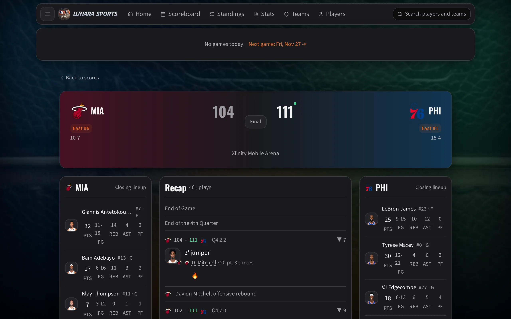
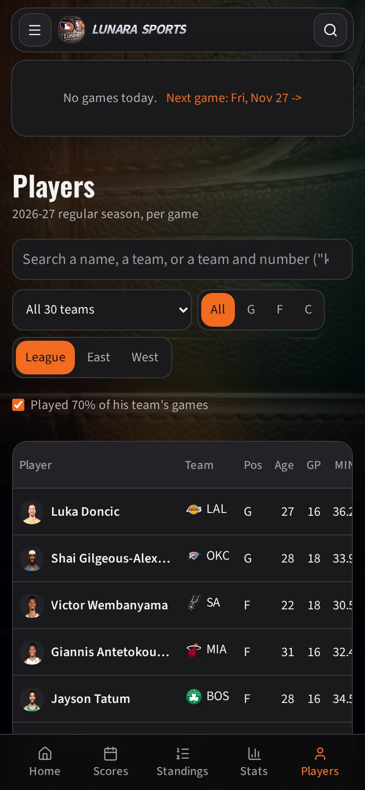

# lunara-sports

Live NBA play by play, from ESPN to the browser within a second or two. A Python ingestion service
polls ESPN during games and writes every game and play to PostgreSQL; a FastAPI service pushes
new plays to browsers over WebSocket and serves scores, box scores, standings and stats; a React
site shows it all.

**Live site:** https://www.lunara-app.com

<p>
  
  
</p>
<p>
  
</p>

The repository has two parts:

1. **Streaming data engineering:** getting live events in, keeping them correct, and getting them
   out fast.
2. **Software development:** the API, the website, the tests and CI.

## Part 1: Streaming data engineering

How a play travels (the intervals are the ones in the code):

1. `ingestion/` polls ESPN's scoreboard every 10 seconds to find live games, and each live game's
   play by play every second. Each poll is bounded to 3 seconds, so a slow game never stalls the
   others.
2. One collector per game remembers each ESPN play id with the fields it last produced and emits
   a play only when it is new or changed. All collectors share one buffered PostgreSQL sink that
   writes in order.
3. When a game ends, its stored plays are reconciled with ESPN's final play list.
4. In `api/`, a poller reads new rows every quarter second and pushes them to the game's
   WebSocket subscribers. The scoreboard reaches every open page every 2 seconds.
5. SQL views in the `analytics` schema turn the stored plays into game flow, scoring runs and
   per-player scoring.

| Area | Path | What it does |
|---|---|---|
| Ingestion | `ingestion/` | Polls ESPN for the scoreboard and each live game's plays, and writes them through one buffered PostgreSQL sink |
| Reconcile | `ingestion/src/reconcile.py` | Makes a finished game's stored plays match ESPN's final play list; a CLI does the same for stored games |
| Database | `storage/postgres/migrations/` | Numbered SQL migrations: games, teams, plays, users, predictions and social tables, and the analytics views |
| Analytics | `storage/postgres/migrations/016_analytics_views.sql` | Views for play flow, quarter scoring, player points, scoring runs and game flow |
| Live fan-out | `api/src/ws/` | The play poller and the WebSocket connection manager, one room per game |
| Monitoring | `monitoring/`, `docker-compose.yml` | Prometheus with PostgreSQL and Redis exporters, a Grafana dashboard, the API's request metrics |
| Real-database tests | `tests/integration/`, `ingestion/tests/test_reconcile_db.py`, `ingestion/tests/test_analytics_db.py` | The sink, the play broadcast poller, reconcile and the views against a real PostgreSQL |

### Data notes

- **A play is identified by ESPN's play id, not its sequence number.** ESPN renumbers plays
  during a game: a play recorded late is inserted and the plays after it shift. When plays were
  keyed on the sequence number, one stored game (CLE @ CHA, 2026-11-09) ended up with 109 of 445
  shared numbers holding a different play than ESPN's final list, 6 stale rows and 8 missing
  plays, and points summed from the stored score changes disagreed with ESPN's box score for 12
  of the 22 players who played. Plays are now upserted on `(game_id, espn_play_id)`, a play is
  written again only when one of its fields changed, and each finished game is reconciled with
  ESPN's final list. `ingestion/tests/test_stored_game_drift.py` checks those figures from the two
  captures, and `ingestion/tests/test_reconcile_db.py` replays the stored game through reconcile.
- **Time order comes from ESPN's list, not from sequence numbers.** In ESPN's final list for that
  game the running score never goes backwards; sorted by sequence number it goes backwards four
  times (`ingestion/tests/test_stored_game_drift.py`). Each play stores its position in ESPN's
  list (`espn_order`), and the API and the views order by it.
- **Points come from ESPN's per-play score value.** Summed over a game, they equal ESPN's box
  score for every player and ESPN's line score for every quarter
  (`ingestion/tests/test_analytics_db.py`).
- **Writes are ordered and survive a database blip.** Collectors share one sink. A flush detaches
  the buffer under a lock, so writes commit in the order they were requested; a transient failure
  puts the batch back ahead of newer events; a row that violates a constraint is retried alone
  and dropped alone (`ingestion/src/sinks/postgres.py`).
- **A slow game does not stall the others.** Each game's play-by-play poll is bounded to 3
  seconds (`ingestion/src/__main__.py`) and retried once at most; scoreboard requests retry with
  exponential backoff; each collector has a circuit breaker that stops calling an endpoint that
  keeps failing (`ingestion/src/resilience/`).

### The analytics views

All in the `analytics` schema, read-only, over plays that carry ESPN's time order:

- `play_flow`: every play with its side, points and margin after it.
- `quarter_scoring`: points per team per quarter.
- `player_points`: points per player per game, with how many threes, twos and free throws made
  them.
- `scoring_runs`: consecutive points by one side with no points by the other (gaps and
  islands over the scoring plays).
- `game_flow`: lead changes, ties, each side's largest lead, the longest run and the final
  margin, one row per game.

On the stored CLE @ CHA game they give ESPN's own figures: line scores 29-40-38-17 and
28-25-27-32, the largest leads (33 and 9) and 3 lead changes.

## Part 2: Software development

| Area | Path | What it does |
|---|---|---|
| API | `api/` | FastAPI: REST for games, plays, box scores, standings, teams, players and stats; WebSocket feeds for the scoreboard and each game; JWT sign-in. ESPN reads go through a Redis cache with a lifetime per endpoint |
| Players table | `api/src/services/stats_service.py` | `GET /stats/players`: every player with stats this season, sortable by any column, 25 per page, searchable by name, team or team and number ("knicks 11"), with team, position and conference filters and the NBA's games rule |
| Leaders | `api/src/routers/stats.py` | `GET /stats/leaders/{category}`: the leaders in nine categories under the NBA's qualifying rules, and every team's per-game numbers |
| Website | `frontend/` | React 18, Vite and Tailwind v4: the scoreboard, game pages with live play by play and box scores, standings, teams, stats and the Players table. Every row is one link |
| Design check | `frontend/scripts/check-design.mjs` | Keeps the design rules in code: colors only from the tokens, no off-system effects, type weights and copy, run in CI |
| Tests | `api/tests/`, `ingestion/tests/`, `frontend/src/**/*.test.*` | Unit tests per service with a 99.1% line and branch coverage gate; the website's tests run against recorded API responses |
| CI | `scripts/check.sh`, `.github/workflows/ci.yml` | Lint, the API and ingestion suites, the real-PostgreSQL tests and the website (tests, design check, production build) |

The site's art and its browser test suite, with the images it uses, are not in this repository
(so `npm run e2e` has nothing to run here).
`frontend/src/addons/index.js` loads optional parts of the site when they are present; this
repository has none.

## Run it

Requirements: Linux, Docker, Python 3.12 with its `venv` module (`python3.12-venv` on Debian and
Ubuntu), the `psql` client, and Node 22 for the website.

```bash
cp .env.example .env
make infra          # PostgreSQL, Redis, Prometheus, Grafana; waits for PostgreSQL
make db-migrate     # apply storage/postgres/migrations in order
make dev-ingestion  # poll ESPN and write to PostgreSQL (runs in the foreground)
```

and in a second terminal:

```bash
make dev-api        # the API on 127.0.0.1:8000 (docs at /docs)
```

and in a third, the website against that API:

```bash
make dev-web        # the site on 127.0.0.1:3000
```

The two Python services each get their own environment in `.ci/` (built by `make envs`, which
the dev targets run first): both ship a top-level package named `src`, so they never share one.

## Tests

```bash
make test      # lint, the API and ingestion suites, and the website (no database needed)
make test-db   # all of that plus the real-PostgreSQL tests, on a throwaway postgres:16 container
```

`scripts/check.sh` is what both run, and what CI runs. Recorded responses used by the tests are
listed, with when they were recorded, in `api/tests/fixtures/README.md`,
`tests/fixtures/espn/README.md` and `frontend/e2e/fixtures/README.md`.
